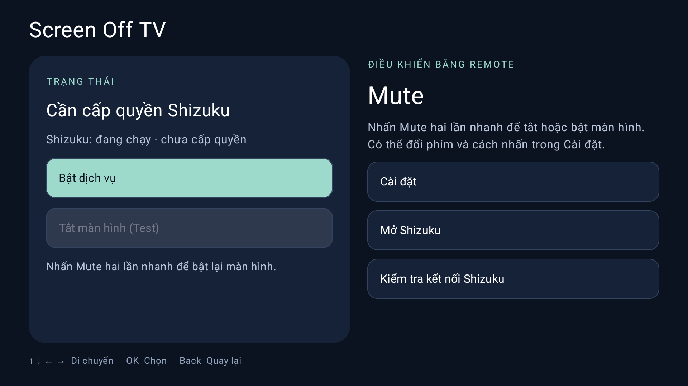

# Screen Off TV — Tắt màn hình TV vẫn nghe nhạc và âm thanh phim

[**Hướng dẫn cài đặt có ảnh**](docs/INSTALL.md) · [**Hướng dẫn cài đặt cho AI agent**](docs/AGENT-INSTALL.md)

[English](README.md) · **Tiếng Việt** · [简体中文](README.zh-CN.md)

Screen Off TV giúp **tắt màn hình Android TV bằng remote trong khi nhạc hoặc video vẫn tiếp tục phát**. Bạn có thể nghe nhạc, podcast, bài giảng hoặc âm thanh phim mà không cần bật màn hình. Ứng dụng dùng **Shizuku**, hỗ trợ tiếng Việt, tiếng Anh và tiếng Trung giản thể. Khả năng tắt màn hình và tiếp tục phát âm thanh tùy thuộc TV và trình phát.



## Tính năng

- Dùng remote để tắt và bật lại màn hình bằng một lần nhấn, hai lần nhấn nhanh hoặc giữ 0,6 giây.
- Chọn Mute, tăng âm lượng, giảm âm lượng hoặc nhận một phím khác từ remote. Phím mới được lưu sau khi xác nhận và vẫn giữ chức năng gốc trên TV.
- Chọn **Screen Off / Picture Off** hoặc **Tắt đèn nền**.
- Tự khởi động cùng TV, có thể tắt trong Cài đặt.
- Điều hướng bằng phím mũi tên và OK trên remote.
- Chọn tiếng Việt, tiếng Anh, tiếng Trung giản thể hoặc **Theo hệ thống**.

## Yêu cầu

- Android TV 8.0 trở lên.
- Shizuku đang chạy, Screen Off TV đã được cấp quyền sử dụng Shizuku.
- Android 11 trở lên và mục **Wireless debugging / Gỡ lỗi không dây** để khởi động Shizuku qua Wi-Fi.

Screen Off TV điều khiển màn hình, không phát nhạc/video và không bổ sung chức năng phát nền cho ứng dụng khác.

## Tải và cài đặt

[**Tải APK 0.1.6**](https://github.com/thaicuonght/ScreenOffTV/raw/refs/heads/main/dist/Screen-Off-TV-0.1.6.apk) · [SHA-256](dist/SHA256SUMS)

APK được ký bằng khóa phát hành riêng.

### Tự cài đặt

Cài và khởi động theo [hướng dẫn cài đặt có ảnh](docs/INSTALL.md).

### Nhờ AI agent cài đặt

Dùng agent có công cụ kết nối ADB và điều khiển giao diện TV. Sao chép prompt sau, cung cấp địa chỉ/cổng TV hoặc xác nhận kết nối khi agent cần:

```text
Đọc hướng dẫn và hồ sơ APK được dẫn trong đó:
https://raw.githubusercontent.com/thaicuonght/ScreenOffTV/main/docs/AGENT-INSTALL.md

Cài đặt hoàn chỉnh thedjchi/Shizuku và Screen Off TV trên TV của tôi từ APK có sẵn. Kết nối TV, xác minh đúng fork, khởi động Shizuku, cấp quyền, cấu hình và đọc lại cài đặt cả hai ứng dụng theo hướng dẫn. Báo bằng chứng cho từng mục required_installation_evidence trong JSON. Chỉ báo hoàn tất khi Shizuku đang chạy và Screen Off TV đã được cấp quyền, sẵn sàng điều khiển. Nếu bị chặn, báo rõ bước còn thiếu và chỉ hỏi thông tin hoặc thao tác cần tôi hỗ trợ.
```

Cài đặt chỉ cần APK, phần build bên dưới dành cho phát triển mã nguồn.

## Cách sử dụng

Phím tắt mặc định là **Mute, nhấn hai lần nhanh**. Ứng dụng nhận lệnh ngay khi nhấn lần thứ hai, không cần chờ nhả phím.

1. Bật dịch vụ Screen Off TV và kiểm tra trạng thái **Sẵn sàng điều khiển**.
2. Mở nhạc hoặc video trong trình phát bạn thường dùng, xác nhận đang có âm thanh.
3. Nhấn Mute hai lần nhanh để tắt màn hình.
4. Nhấn Mute hai lần nhanh lần nữa để bật lại màn hình.

Nếu đã đổi phím hoặc thao tác, dùng lựa chọn của bạn thay cho Mute hai lần. Phím vẫn giữ chức năng gốc trên TV nên hãy kiểm tra trước khi sử dụng. Không dùng Nguồn, OK, Back hoặc các phím mũi tên làm phím tắt.

Nếu âm thanh dừng, bật lại màn hình và kiểm tra trình phát. Có thể thử chế độ tắt màn hình còn lại sau khi dừng dịch vụ. Nếu không bật lại được màn hình bằng phím tắt, dùng thao tác khởi động lại hoặc điều khiển nguồn của TV để khôi phục.

### Đổi phím remote

Vào **Cài đặt → Phím điều khiển**:

- **Phím có sẵn:** chọn phím để lưu ngay.
- **Phím khác trên remote:** bật dịch vụ trước, chọn **Nhận một phím khác từ remote**, nhấn phím muốn dùng rồi chọn **Xác nhận dùng phím này**. Hộp thoại tự đóng sau khi xác nhận.

Xem [hướng dẫn đổi sang nút RED](docs/INSTALL.md#8-đổi-sang-nút-red-màu-đỏ--tùy-chọn) nếu cần ví dụ từng bước.

## Hai chế độ tắt màn hình

| Chế độ | Cách hoạt động |
|---|---|
| **Screen Off / Picture Off** — mặc định | Chuyển màn hình sang trạng thái tắt, bật lại bằng cách khôi phục trạng thái màn hình. TV vẫn hoạt động. |
| **Tắt đèn nền / Brightness = -1** | Dùng giá trị độ sáng đặc biệt `-1` để yêu cầu tắt đèn nền, khôi phục độ sáng đã lưu khi bật lại. Không phải giảm độ sáng xuống `0`. |

Cả hai chế độ đều dùng Shizuku và cần TV hỗ trợ. Dừng dịch vụ trước khi đổi chế độ. Ứng dụng không gửi lệnh tắt nguồn hay đưa TV vào chế độ chờ. Khả năng tiếp tục phát âm thanh tùy thuộc TV và trình phát.

## Tự khởi động cùng TV

Tùy chọn **Tự khởi động cùng TV** được bật mặc định. Để sử dụng, cần bật thêm **Bắt đầu khi khởi động / Start on boot** trong Shizuku và giữ Wi-Fi sẵn sàng sau khi TV khởi động.

Nếu Shizuku khởi động muộn hoặc mất kết nối, Screen Off TV sẽ tiếp tục chờ và tự kết nối lại. Ứng dụng chỉ báo sẵn sàng khi có thể điều khiển màn hình và nhận phím remote. Nếu bạn đã tắt tùy chọn tự khởi động, ứng dụng sẽ giữ nguyên lựa chọn đó khi mở lại.

Xem [cách thiết lập Shizuku tự khởi động](docs/INSTALL.md#5-bật-shizuku-khởi-động-cùng-tv) và [cách kiểm tra sau khi khởi động lại TV](docs/INSTALL.md#9-kiểm-tra-tính-năng-và-tự-khởi-động).

## Khả năng tương thích

Bản phát hành này chưa được kiểm thử trên TV. Khả năng tắt màn hình và giữ âm thanh tùy firmware TV và trình phát. Xem [kết quả kiểm tra](docs/TESTING.md).

## Ngôn ngữ

Mặc định là **Theo hệ thống**. Vào **Cài đặt → Ngôn ngữ / Language** để chọn **Theo hệ thống**, **Tiếng Việt**, **English** hoặc **简体中文**.

Nếu ngôn ngữ TV chưa được hỗ trợ, ứng dụng dùng tiếng Anh. Lựa chọn được lưu lại. Đổi ngôn ngữ không thay đổi cài đặt remote hoặc khởi động lại dịch vụ đang chạy.

## Build và kiểm thử

Phiên bản **0.1.6**, versionCode **6**, mã ứng dụng `com.thaicuonght.screenofftv`.
Cần JDK 17 và Android SDK platform 35. Cấu hình `JAVA_HOME`, `ANDROID_HOME`.

```bash
./gradlew :app:assembleDebug :app:testDebugUnitTest :ipc:testDebugUnitTest :shizuku-service:testDebugUnitTest
./gradlew :app:assembleDebugAndroidTest :app:lintDebug
./gradlew :app:assembleRelease
```

APK debug: `app/build/outputs/apk/debug/app-debug.apk`.
Để ký bản release, sao chép `signing.properties.example` thành `signing.properties` và cấu hình khóa riêng. Khi có cấu hình ký, APK ở `app/build/outputs/apk/release/app-release.apk`; khi chưa có sẽ tạo APK chưa ký. Không commit khóa hoặc mật khẩu. Sao lưu khóa phát hành riêng và dùng cùng khóa cho các bản cập nhật.

Kiểm thử giao diện cần thiết bị kết nối: `./gradlew :app:connectedDebugAndroidTest`.

## Cấu trúc dự án

- `app/`: giao diện TV, ngôn ngữ, cài đặt remote, dịch vụ nền và kiểm thử.
- `hidden-api/`: truy cập API màn hình Android.
- `ipc/`: dữ liệu trao đổi giữa các tiến trình.
- `shizuku-service/`: điều khiển màn hình và nhận phím remote qua Shizuku.
- `design/`: ảnh biểu tượng gốc.
- `fastlane/`: thông tin phân phối bằng tiếng Anh, Việt và Trung giản thể.

## Quyền riêng tư và giấy phép

Cài đặt được lưu trên thiết bị. Ứng dụng không có quảng cáo, phân tích hành vi hoặc dịch vụ tải dữ liệu người dùng lên máy chủ. Android có thể sao lưu cài đặt theo cấu hình thiết bị.

Dự án sử dụng và sửa đổi mã nguồn GPL v3. Xem [LICENSE](LICENSE) và [THIRD_PARTY_NOTICES.md](THIRD_PARTY_NOTICES.md) để biết nguồn mã và thông báo thư viện.
